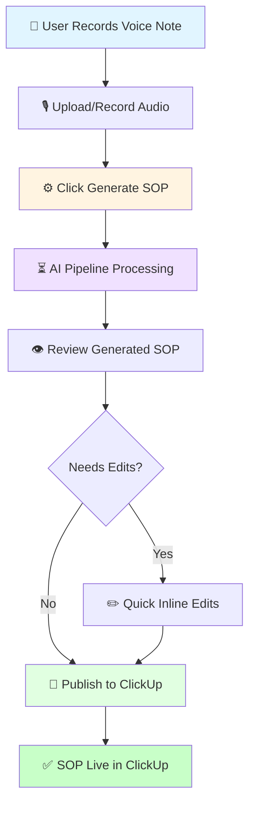
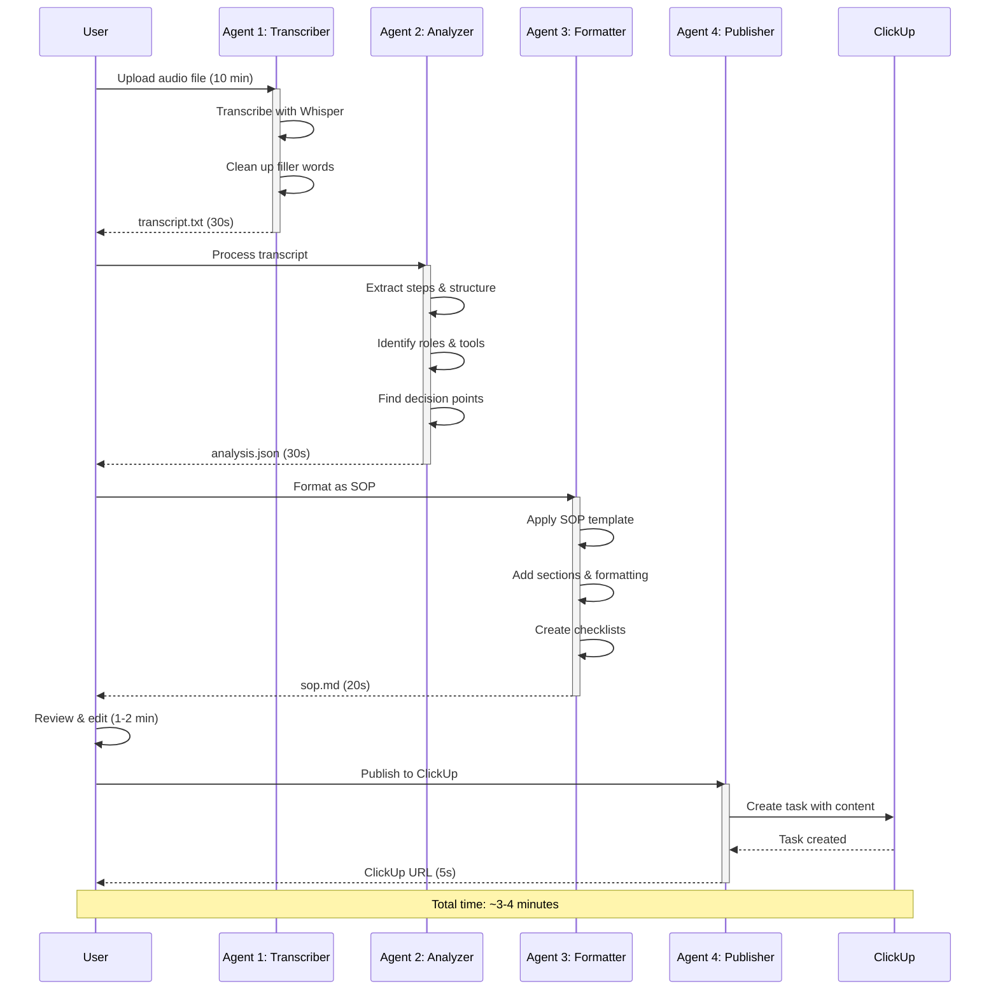
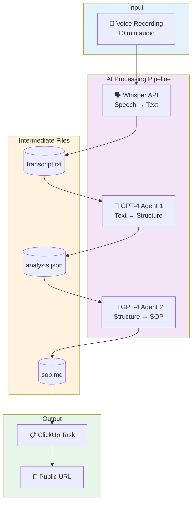
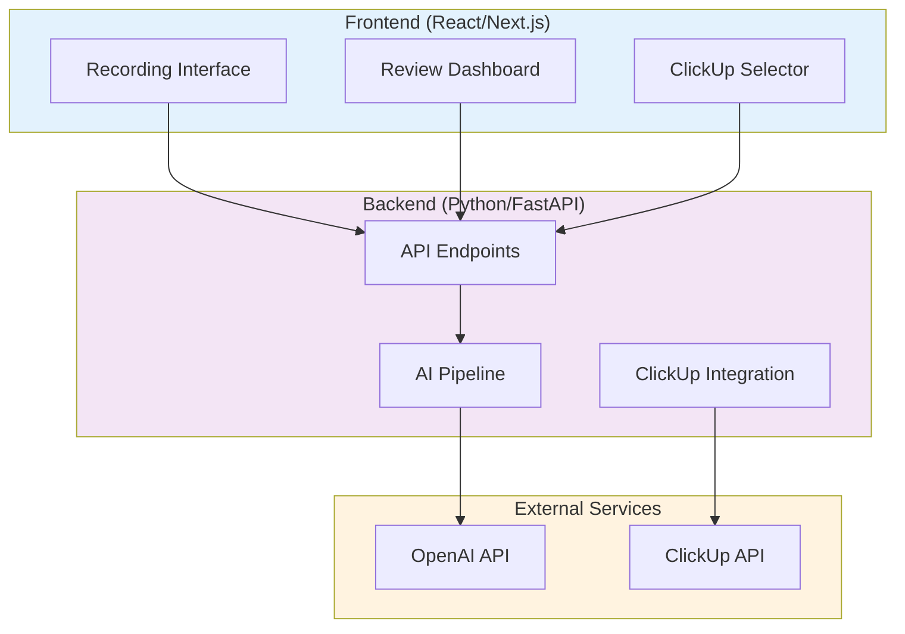
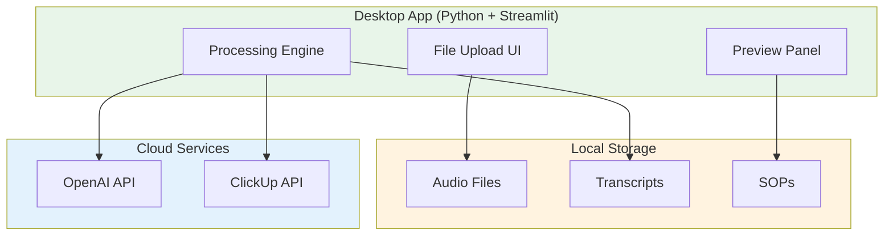
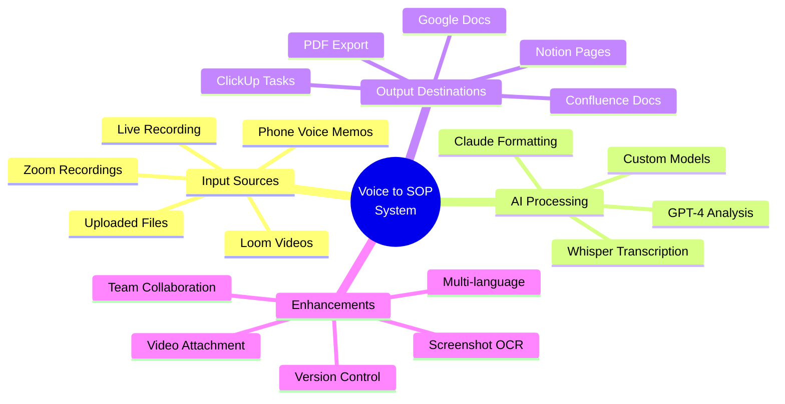
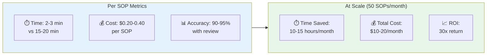

# Voice Note to ClickUp SOP - Workflow Diagrams

## High-Level User Flow



## Technical Pipeline (4-Agent System)

```mermaid
graph LR
    A[🎤 Audio File] --> B[Agent 1: Transcription]
    B --> C[📝 Clean Transcript]
    C --> D[Agent 2: Process Analysis]
    D --> E[📊 Structured Data]
    E --> F[Agent 3: SOP Formatting]
    F --> G[📄 Formatted SOP]
    G --> H[Agent 4: ClickUp Publisher]
    H --> I[✅ Published Task]
    
    style B fill:#ffcccc
    style D fill:#ccffcc
    style F fill:#ccccff
    style H fill:#ffffcc
```



## Detailed Agent Flow



## Data Flow Architecture



## Comparison: Current vs. Proposed Workflow

```mermaid
graph TB
    subgraph Current["Current Workflow (15-20 min)"]
        C1[Record voice in ChatGPT] --> C2[Close voice & ask for SOP]
        C2 --> C3[Review output]
        C3 --> C4[Make adjustments]
        C4 --> C5[Walk through again]
        C5 --> C6[Tell ChatGPT changes]
        C6 --> C7[Copy to ClickUp manually]
        C7 --> C8[Record video]
    end
    
    subgraph Proposed["Proposed Workflow (2-3 min)"]
        P1[Record voice anywhere] --> P2[Upload to app]
        P2 --> P3[Click 'Generate']
        P3 --> P4[AI processes automatically]
        P4 --> P5[Quick review]
        P5 --> P6[Click 'Publish']
        P6 --> P7[Record video if needed]
    end
    
    style Current fill:#ffebee
    style Proposed fill:#e8f5e9
```



## System Architecture Options

### Option A: Web Application



### Option B: Desktop Application



## Integration Possibilities



## Cost & Performance Metrics



---

## How to Use These Diagrams

1. **Copy any diagram** above into a Markdown file
2. **View on GitHub** - GitHub automatically renders Mermaid diagrams
3. **Use in Notion/Confluence** - Many tools support Mermaid
4. **Convert to image** - Use [mermaid.live](https://mermaid.live/) to export as PNG/SVG
5. **Share in Slack** - Convert to image first, or share the live link

## Tools for Viewing Mermaid Diagrams

- **Online Editor**: [mermaid.live](https://mermaid.live/)
- **VS Code Extension**: Mermaid Preview
- **Browser Extension**: Mermaid Diagrams (Chrome/Firefox)
- **Command Line**: `mmdc` (mermaid-cli)

```bash
# Install mermaid CLI
npm install -g @mermaid-js/mermaid-cli

# Convert to PNG
mmdc -i workflow.mmd -o workflow.png
```
